# Rust Watch: firmware for the Waveshare ESP32-S3-Touch-AMOLED-2.06

A complete smartwatch firmware written in **100% Rust, `no_std`, bare metal** (esp-hal 1.0 + Embassy async), for the [Waveshare ESP32-S3-Touch-AMOLED-2.06](https://www.waveshare.com/esp32-s3-touch-amoled-2.06.htm).
It started from [infinition/waveshare-watch-rs](https://github.com/infinition/waveshare-watch-rs) and grew into a daily-wear watch with 20+ apps, Home Assistant integration, a flash-backed battery logger and a lot of work on battery life.

<p align="center">
  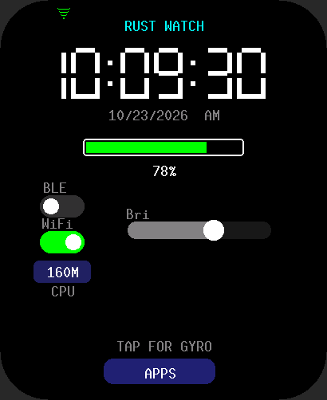
  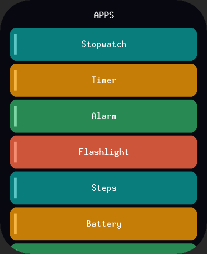
  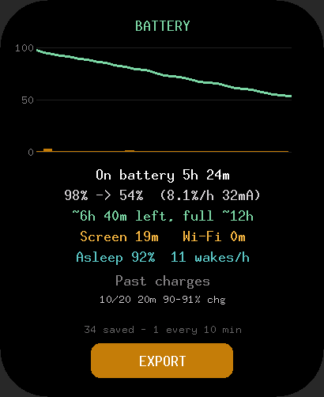
  
</p>

> All screenshots are rendered on a PC from the real firmware drawing code (see [`tools/preview`](tools/preview)), so they are pixel-exact to what the 410×502 AMOLED shows, with the panel's rounded corners masked in.

---

## Contents
- [Features](#features)
- [Screens](#screens)
- [Hardware](#hardware)
- [Building](#building)
- [Flashing](#flashing)
- [Battery log & export](#battery-log--export)
- [How the firmware is put together](#how-the-firmware-is-put-together) (full write-up: [docs/ARCHITECTURE.md](docs/ARCHITECTURE.md))
- [Credits & license](#credits--license)

## Features

**Watch**
- 7-segment watch face with date, battery bar, Wi-Fi / BLE toggles, brightness slider, CPU speed, tilt "gyro ball"
- Always-on display (super-dim HH:MM, one redraw per minute), Big Clock page
- Swipe pages: Clock → Big Clock → Sensors → System → Power monitor
- Time from the PCF85063A RTC, synced over Wi-Fi with NTP (US Eastern, automatic DST)

**Apps** (scrollable launcher, drag + fling)
| Tools | Smart home | Games & toys |
|---|---|---|
| Stopwatch (laps), Timer, Alarm (wakes the watch from sleep), Flashlight (white / soft / red), Steps, Battery, Calculator, Spirit Level, Dice, Sun & Moon, Wi-Fi QR, Settings | Smart Home (webhook buttons), Home Status, Weather, Fleet (Home Assistant template API) | Waves (3D fluid), Ball Pit (particle fluid), Asteroids, Tic-Tac-Toe, Tetris, Tilt Maze |

**Power & reliability**
- Event-driven Embassy main loop: no busy polling, the CPU waits on timers and GPIO interrupts
- Screen states: bright → dim (8 s) → AOD (15 s) → off (3 min); light sleep when the screen is off and USB is unplugged, waking every 5 min for housekeeping
- Touch or BOOT wakes the watch instantly from light sleep
- Radio off by default; Wi-Fi turns itself off after 5 min idle
- Runtime CPU frequency switching (80 / 160 / 240 MHz)
- Flash-backed **battery log** (about 2 weeks of history) that survives a dead battery and re-flashing, exportable over USB serial or Wi-Fi
- Crash capture: panic message, reset reason, power-chip on/off cause and a breadcrumb trail of the last main-loop steps are recorded and shown after the restart
- RTC watchdog and I2C bus recovery so a stuck sensor can't freeze the watch

## Screens

| | | | |
|:-:|:-:|:-:|:-:|
| <br>Watch face | 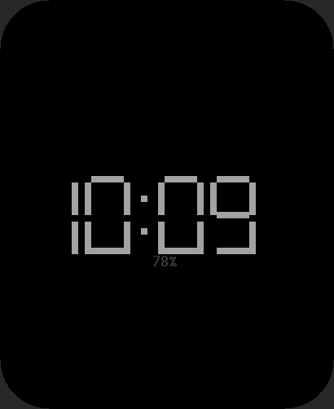<br>Always-on | 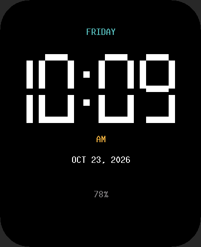<br>Big Clock | 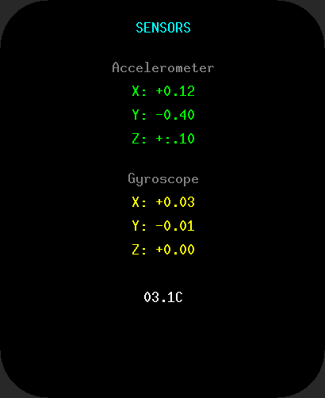<br>Sensors |
| 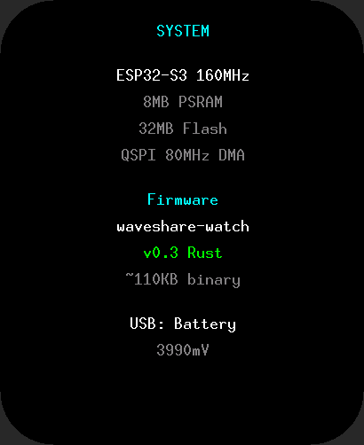<br>System | 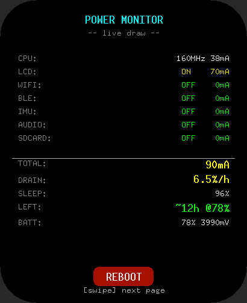<br>Power monitor | <br>Launcher | 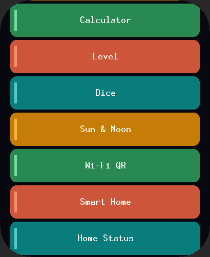<br>Launcher (scrolled) |
| 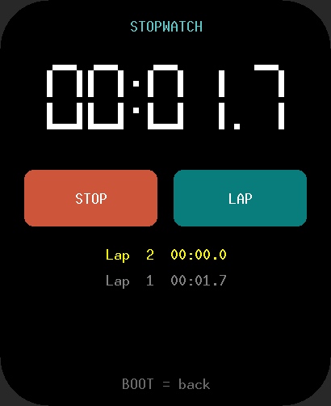<br>Stopwatch | 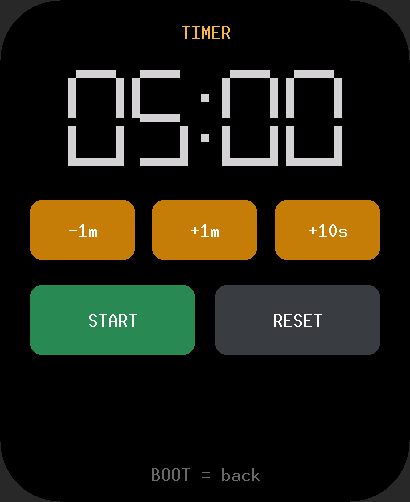<br>Timer | 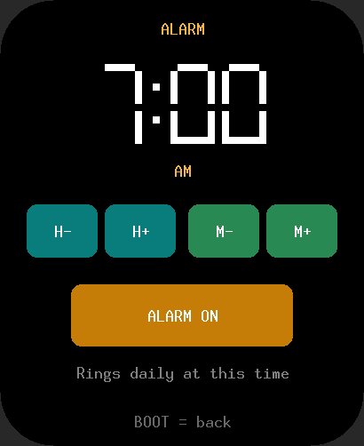<br>Alarm | 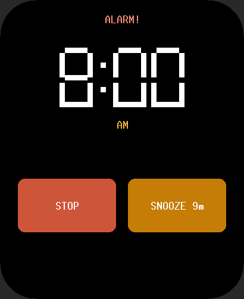<br>Alarm ringing |
| 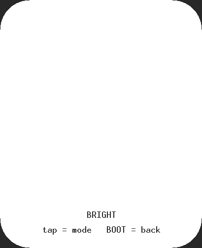<br>Flashlight | 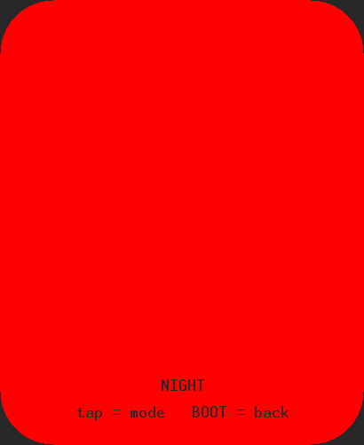<br>Flashlight (night) | 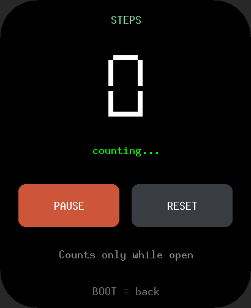<br>Steps | <br>Battery |
| 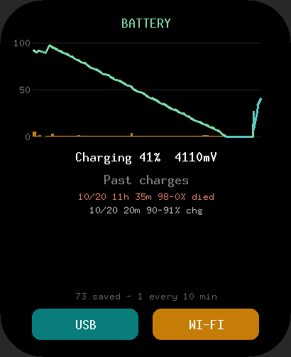<br>Battery (charging) | 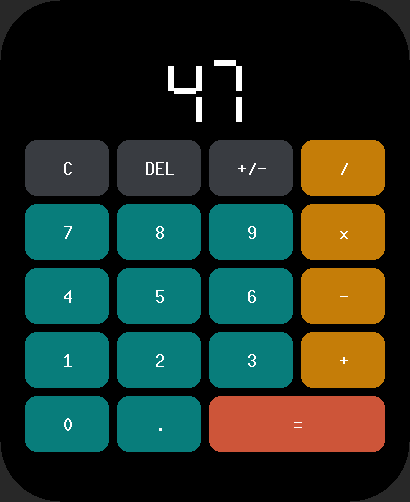<br>Calculator | 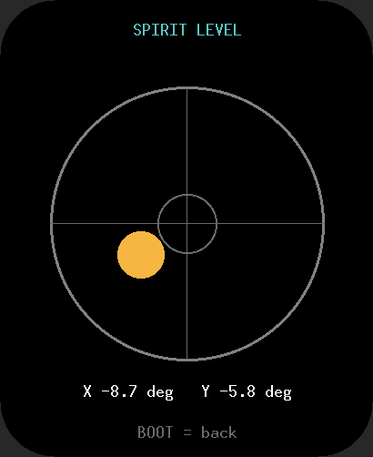<br>Spirit level | 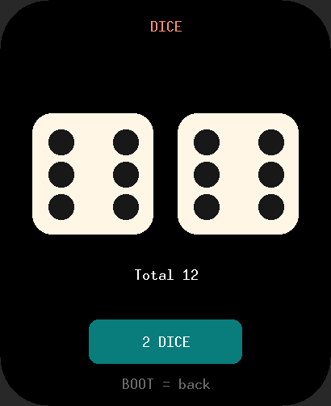<br>Dice |
| 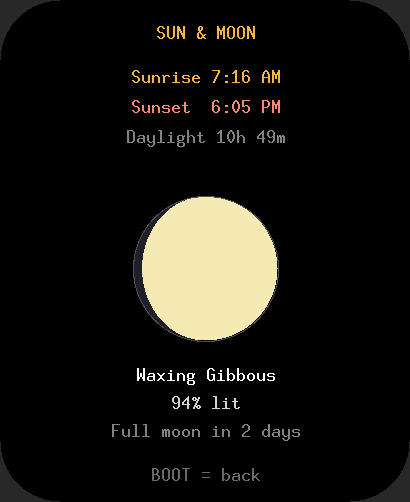<br>Sun & Moon | 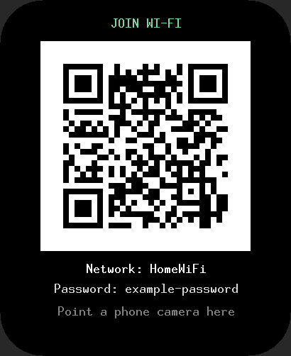<br>Wi-Fi QR | 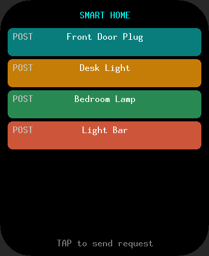<br>Smart Home | 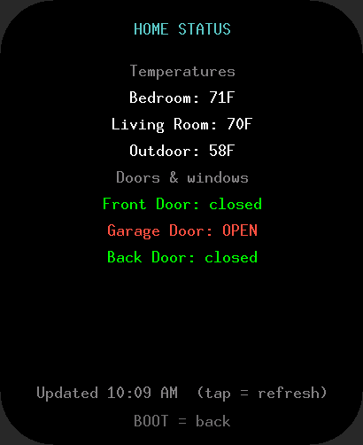<br>Home Status |
| 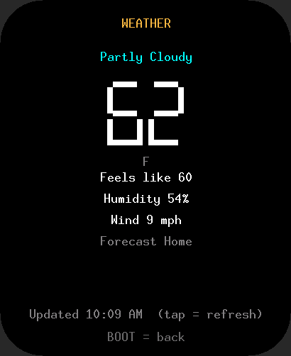<br>Weather | 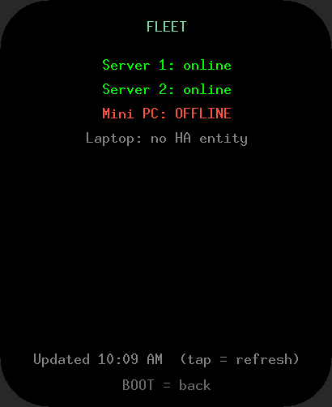<br>Fleet | <br>Waves | <br>Ball Pit |
| 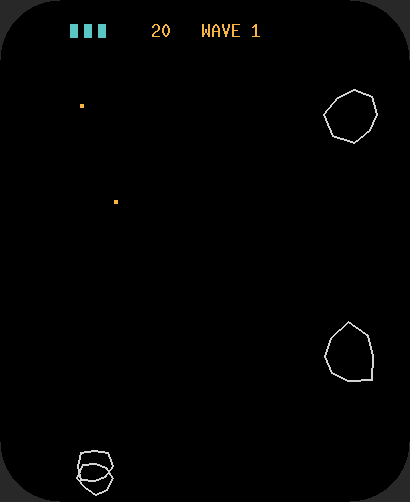<br>Asteroids | 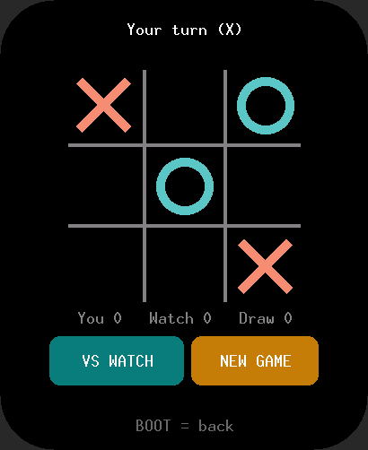<br>Tic-Tac-Toe | 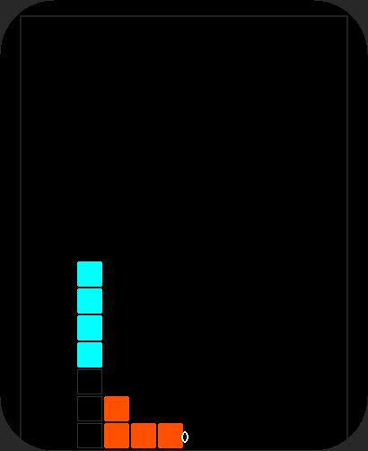<br>Tetris | 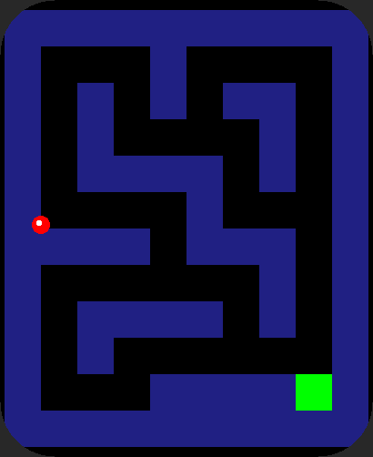<br>Tilt Maze |
| 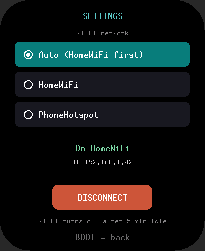<br>Settings: Wi-Fi | 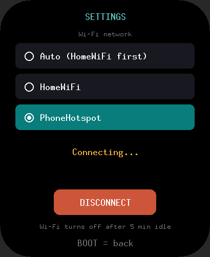<br>Settings: hotspot | | |

The screenshots use placeholder network names and a dummy password.

## Hardware

| Part | Chip | Bus |
|---|---|---|
| SoC | ESP32-S3R8 (dual-core Xtensa LX7 @ 240 MHz, 8 MB octal PSRAM, 32 MB flash) | |
| Display | 2.06" 410×502 AMOLED, CO5300 controller | QSPI @ 80 MHz with DMA, TE sync |
| Touch | FT3168 | I2C 0x38, INT on GPIO38 |
| Power | AXP2101 PMIC + fuel gauge | I2C 0x34 |
| IMU | QMI8658 6-axis | I2C 0x6B |
| RTC | PCF85063A | I2C 0x51 |
| Audio | ES8311 codec + ES7210 mic ADC, speaker amp | I2S |
| Storage | microSD | SPI3 |
| Buttons | BOOT (GPIO0, used as Back / wake), PWR (via AXP2101) | |

Full pin map: [`src/board.rs`](src/board.rs). Battery figures in this repo are for a 400 mAh cell.

## Building

1. Install the Xtensa Rust toolchain and the flasher:
   ```sh
   cargo install espup espflash
   espup install          # installs the "esp" toolchain pinned by rust-toolchain.toml
   ```
   On Windows also install the MSVC build tools ("Desktop development with C++").
2. Set the build-time settings. They are compiled into the image (`option_env!`), so nothing secret lives in the source:

   | Variable | Used for | Required |
   |---|---|---|
   | `WIFI_SSID`, `WIFI_PASS` | Home network (NTP, Home Assistant, Wi-Fi export) | yes, for Wi-Fi |
   | `WIFI2_SSID`, `WIFI2_PASS` | Second network, e.g. a phone hotspot (Settings → Wi-Fi) | no |
   | `HA_HOST` | Home Assistant LAN address, `IPv4:port`, plain HTTP | for HA apps |
   | `HA_TOKEN` | Home Assistant long-lived access token | for Home Status / Weather / Fleet |

   PowerShell:
   ```powershell
   $env:WIFI_SSID="MyWiFi"; $env:WIFI_PASS="..."; $env:HA_HOST="192.168.1.50:8123"; $env:HA_TOKEN="..."
   cargo build --release
   ```
   Bash:
   ```sh
   WIFI_SSID=MyWiFi WIFI_PASS=... HA_HOST=192.168.1.50:8123 HA_TOKEN=... cargo build --release
   ```

Because the credentials are baked in, **never publish a built `.bin`**; `.gitignore` already excludes them.

## Flashing

Always name the serial port explicitly. With several ESP boards plugged in, letting the tool guess can flash the wrong device.

**espflash** (replace `COM4` with your watch's port, e.g. `/dev/ttyACM0` on Linux):
```sh
espflash flash --port COM4 --monitor target/xtensa-esp32s3-none-elf/release/waveshare-watch-rs
```

**Single merged image** (handy for the browser flasher):
```sh
espflash save-image --chip esp32s3 --merge --skip-padding --flash-size 32mb \
  target/xtensa-esp32s3-none-elf/release/waveshare-watch-rs watch-merged.bin
```
Then open [esptool-js](https://espressif.github.io/esptool-js/), choose the watch's port in the picker, and write `watch-merged.bin` at address **0x0**. Close the tab afterwards: it holds the port and resets the watch.

## Battery log & export

The watch records a 16-byte entry about every 10 minutes (plus one at every boot and cable plug/unplug) into a 64 KB ring in flash at `0x00C0_0000`. Flashing a new image doesn't touch it, and it survives the battery running flat.

Each entry holds battery %, voltage, screen-on / Wi-Fi-on / awake / light-sleep time, timer vs touch wake counts, charging/USB flags, and on boot entries the reset reason, power-chip on/off cause and the last main-loop steps before the restart.

The **Battery** app graphs the current charge, estimates drain in mA and time left, and lists past charges. Export it as CSV:

- **USB serial**: plug in and run [`tools/watch-serial.ps1`](tools/watch-serial.ps1). It opens the port without toggling DTR/RTS (so the watch isn't reset), sends `EXPORT`, and saves `watch-battery.csv` to your Desktop:
  ```powershell
  $ComPort = 'COM4'; Invoke-Expression (Get-Content .\tools\watch-serial.ps1 -Raw)
  ```
- **Wi-Fi**: Battery → WI-FI; the watch shows its IP and serves `http://<ip>/battery.csv` for 3 minutes.

CSV columns: `seq,date,time,pct,mv,volt_pct,screen_s,wifi_s,usb,charging,boot,sleep_s,awake_s,timer_wakes,touch_wakes,reset,pmu_on,pmu_off,boot_info,brownouts`

## How the firmware is put together

```
src/
├── main.rs          boot sequence + the single async main loop (state machines for screen, sleep, Wi-Fi, apps)
├── board.rs         pin map and bus addresses
├── drivers/         display stack: QSPI DMA bus → CO5300 panel driver → PSRAM framebuffer
├── peripherals/     one module per chip/service: touch, power, rtc, imu, audio, sdcard, wifi, ble,
│                    http client, battery log, web export, CPU clock, power estimator
├── ui/              watch face, AOD/big clock, swipe pages, power page, launcher, 7-segment digits, T9 keyboard
└── apps/            one file per app, all drawing through embedded-graphics
tools/
├── preview/         host-side renderer: compiles the real UI code for a PC and writes PNG screenshots
└── watch-serial.ps1 battery-log export over USB serial
```

The short version:
- **One async task does almost everything.** `main()` brings up the I2C bus, power chip, display, touch, RTC, IMU, SD and audio, then enters an event-driven loop. Each pass computes how long it may wait and blocks on `select(timer, touch interrupt, BOOT button)`, so the CPU idles between events. Embassy's network runner is the only other task, and it only runs while Wi-Fi is on.
- **Drawing is decoupled from hardware.** Everything renders into a 410×502 RGB565 framebuffer in PSRAM through `embedded-graphics`' `DrawTarget`, then DMA-flushes to the panel (full frame or just dirty regions). That is also why `tools/preview` can render pixel-exact screenshots on a PC.
- **Apps are plain structs.** Each one has `render(&self, &mut impl DrawTarget)` plus small input methods (`handle_tap`, `update` with touch/swipe/accelerometer). The main loop owns the hardware: it powers the IMU only for apps that need it, runs HTTP requests for the HA apps, and so on.
- **Power is a state machine.** Screen levels 3 (bright) → 2 (dim) → 1 (AOD) → 0 (off). When the screen is off and USB is unplugged, the chip enters light sleep with a 5-minute timer plus touch/BOOT GPIO wake.

Read [docs/ARCHITECTURE.md](docs/ARCHITECTURE.md) for the module-by-module breakdown, the main-loop walkthrough, the sleep/wake details and the hardware quirks found along the way.

## Credits & license

- Original firmware, display/touch/power drivers and the project structure: **[infinition/waveshare-watch-rs](https://github.com/infinition/waveshare-watch-rs)** by Fabien (infinition).
- Waves: adapted from [V4C38/esp32-fluidbox](https://github.com/V4C38/esp32-fluidbox) (MIT).
- Ball Pit: double-density relaxation fluid after Clavet et al. (2005).

Licensed under either of [Apache License 2.0](LICENSE-APACHE) or [MIT](LICENSE-MIT), at your option, the same as the original project.
